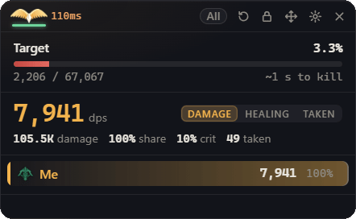
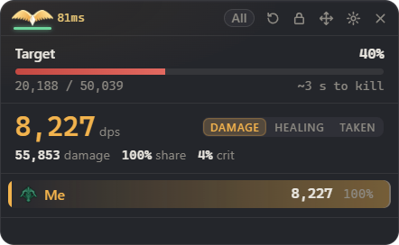
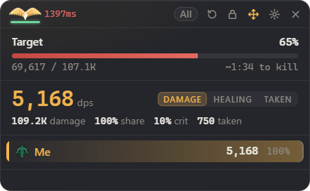
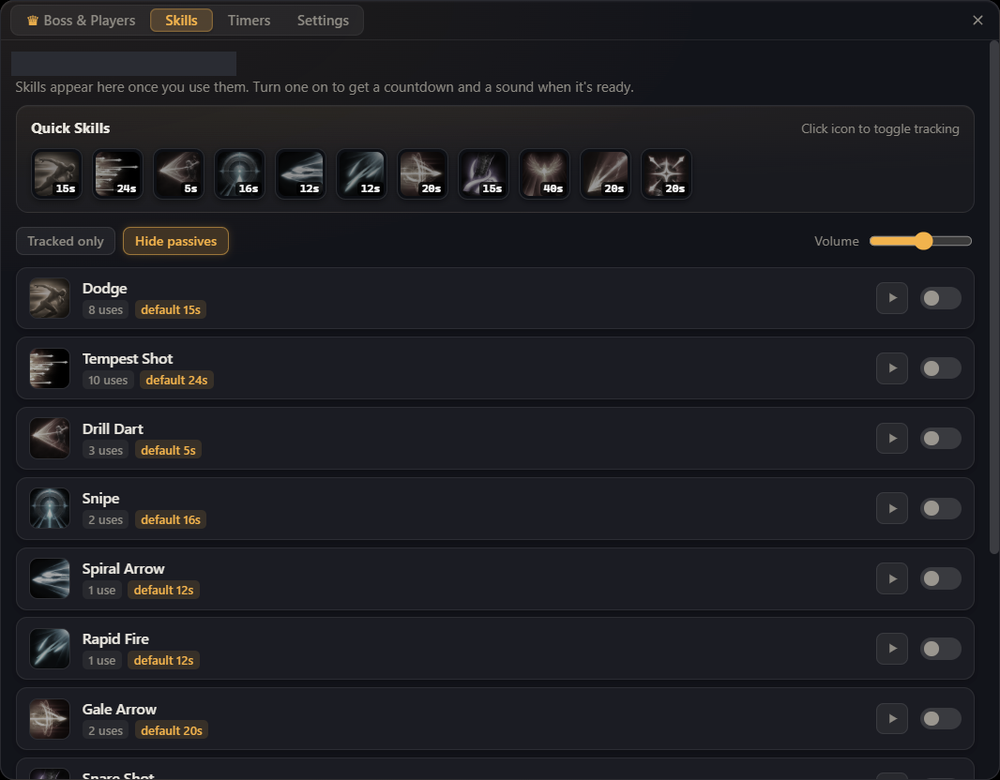
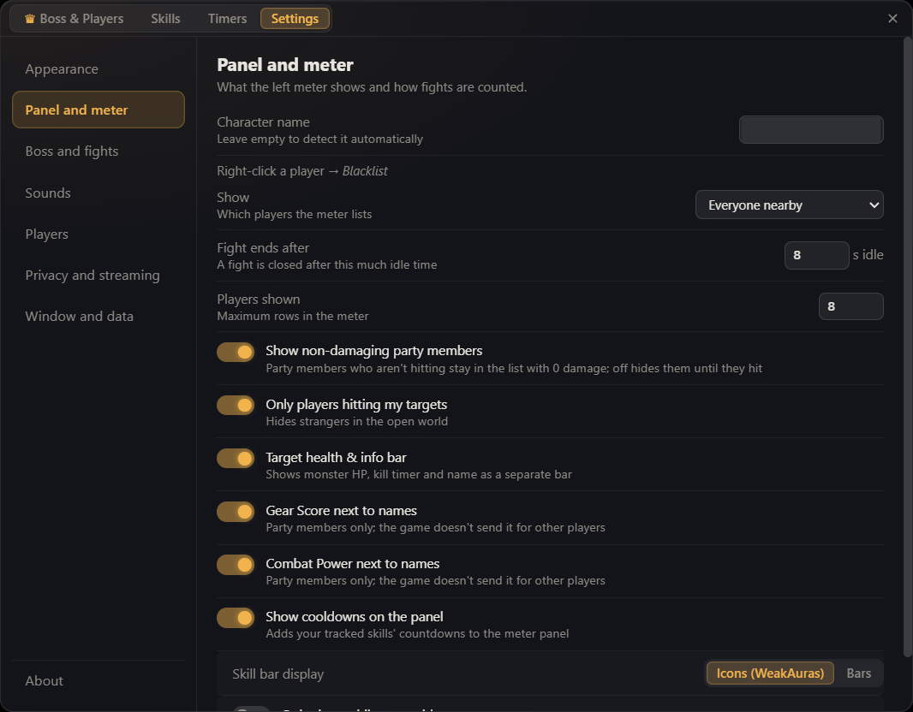
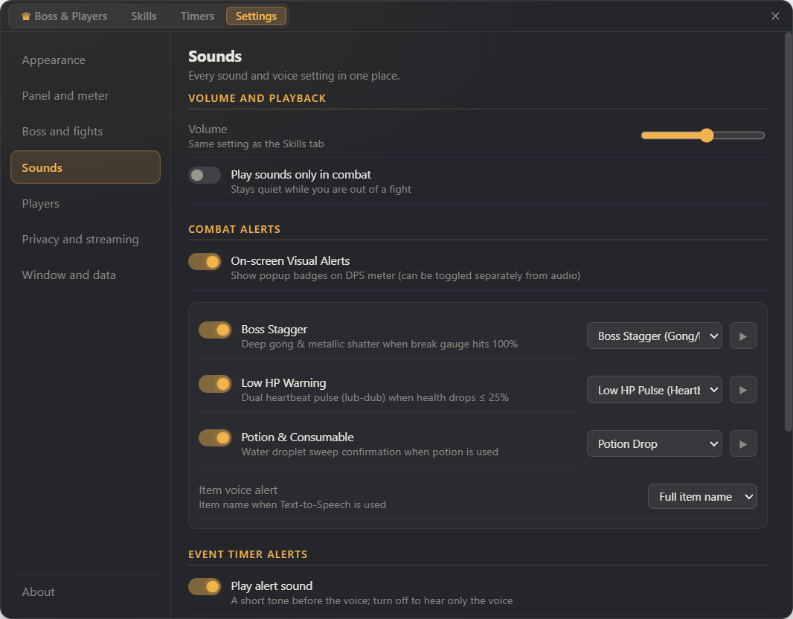
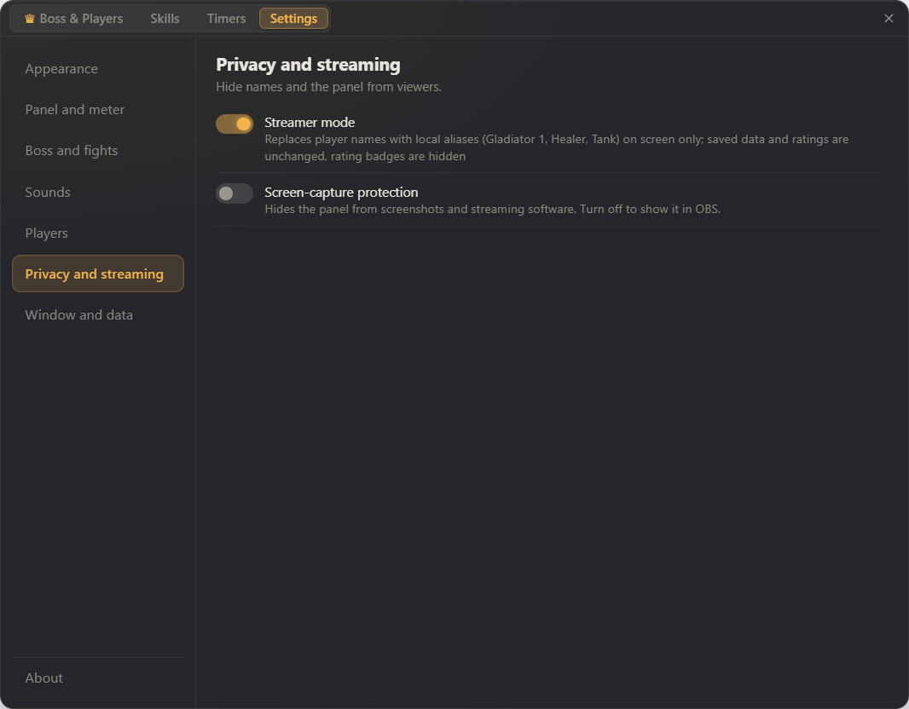
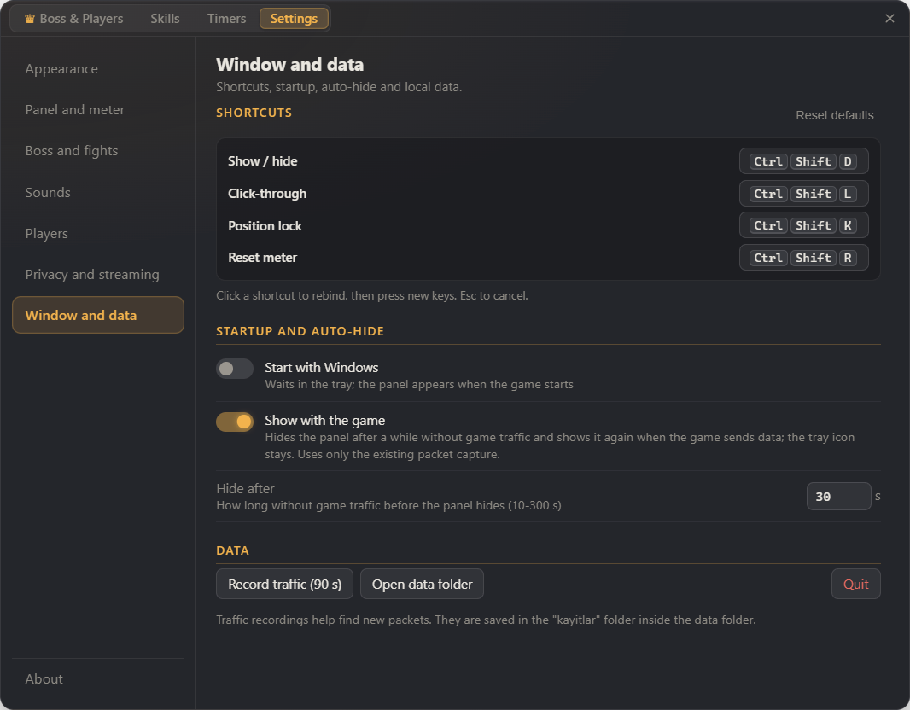

# Daeva Lens

  

**English** · Türkçe: [docs/tr/README.md](docs/tr/README.md)

**Daeva Lens** is a DPS / healing meter and boss helper overlay for **AION 2**. It reads a passive, read-only copy of the game traffic reaching your network card (via Npcap) and shows damage, healing, damage taken, boss and dungeon history, boss timers, player ratings and a skill rotation timeline. Interface: English / Turkish.



| Meter panel | Position lock |
|---|---|
|  |  |

| Skills | Settings: panel and meter |
|---|---|
|  |  |

| Settings: sounds | Settings: privacy | Settings: window and data |
|---|---|---|
|  |  |  |

_All images are the real interface, captured while replaying a local recorded test session (not published) with Streamer mode on, so names appear as aliases. No live game was used. The recording comes from real gameplay (a packet recording replayed inside the program), and the player name is masked._

## Features

- **DPS, healing (HPS) and damage taken:** group and personal views, share, crit rate, per-skill breakdown, death recap.
- **Boss and dungeon history:** every boss fight is saved; in dungeons the main boss (last boss) closes the run card.
- **Four tabs:** Boss and Players, Skills, Timers, Settings.
- **Sounds hub:** all sound and voice settings in one place (Settings > Sounds).
- **Boss timers:** same schedule data as shugo.gg, region selection, beep or spoken alert in English or Turkish.
- **Player ratings and blacklist:** rate players, keep notes, optional red alert when a blacklisted player is in your party. Stored only on your PC.
- **Skill rotation timeline:** per-player skill strip with zoom (wheel / +/- / Fit) and pan.
- **Party display:** option to hide party members who are not dealing damage.
- **Streamer mode:** names replaced with local aliases on screen.

## Install

1. Install **Npcap** from <https://npcap.com/#download> (default options). Daeva Lens does not work without it.
2. Download the release zip from [Releases](https://github.com/W-Code-Hub/daeva-lens/releases/latest) and **extract the whole folder** somewhere permanent.
3. Run `Daeva Lens.exe`. No installation is needed. Settings and the log are written to the `%APPDATA%\Daeva Lens` folder. If auto-start is turned on (it is off by default), it is added to Windows startup.
4. Start AION 2. The panel fills in when combat begins.

**SmartScreen note:** the exe is not code-signed, so Windows may show "Windows protected your PC". Click **More info > Run anyway**. The exe is unsigned because a signing certificate costs money and this is a free hobby project. Antivirus tools may also give a false positive on unsigned programs. Free ways to build trust: you can scan the files on VirusTotal; you can report a false positive to Microsoft at <https://www.microsoft.com/wdsi/filesubmission>. To verify your download, first compare the zip with the `SHA256SUMS.txt` file on the release page:

```
certutil -hashfile "Daeva-Lens-v2.2.0-win-x64.zip" SHA256
```

Then, after extracting the zip, compare `Daeva Lens.exe` with the matching line in the `SHA256SUMS.txt` file inside the extracted folder:

```
certutil -hashfile "Daeva Lens.exe" SHA256
```

## Usage and shortcuts

| Shortcut | Action |
|---|---|
| `Ctrl+Shift+K` | Position lock (prevents moving the panel by accident) |
| `Ctrl+Shift+L` | Click-through (mouse clicks pass to the game) |
| `Ctrl+Shift+D` | Show / hide the panel |
| `Ctrl+Shift+R` | Reset the meter |

All shortcuts can be changed in Settings. Click a player for the skill breakdown; the gear icon opens the four-tab drawer. Full guide: [GUIDE.md](GUIDE.md).

## FAQ

- **Panel shows no data:** is Npcap installed? Restart the app after installing it.
- **Cannot click the panel:** click-through is on - press `Ctrl+Shift+L`.
- **Cannot move the panel:** position lock is on - press `Ctrl+Shift+K`.
- **No spoken alert:** needs a Windows voice for the chosen language; check Settings > Sounds.
- **Panel not visible over the game:** run the game in borderless/windowed mode.
- **Reset everything:** quit and delete `%APPDATA%\Daeva Lens\`.

## Security and honesty

What the source code does (and does not do):

- It **does not read the game's memory**, **does not inject code**, and **does not listen to your keystrokes** (the only global keys are the Electron shortcuts above).
- It **does not send anything over the network:** no HTTP, update or telemetry code; boss timers use your local clock.
- To find the game, the helper program looks at the list of running processes and at the TCP and UDP connection tables (Windows system calls). It writes the processes whose name contains aion, ncsoft or purple to the log. It reads a passive copy of traffic through Npcap and never sends anything to the game server.
- Traffic recording to a local file is optional and off by default. Settings and data live in `%APPDATA%\Daeva Lens\`.

**There is no official approval from NCSOFT.** NCSOFT's published rules (plaync.com/policy/operation/aion2) neither explicitly forbid nor explicitly allow packet reading or overlay panels. No known ban case was found, but that is not an approval. **No guarantee is given that you will not be sanctioned or banned; the risk is yours.**

The helper `a2co-capture.exe` is also GPL-3.0 free software; its source is in `capture/` (see [BUILD.md](BUILD.md)).

## Build from source

See [BUILD.md](BUILD.md) (step by step: Node.js, `npm install`, `npm test`, `npm run dist`). The capture helper source is in `capture/`.

Full tests need local game recordings; for privacy reasons the recordings are not published, so those tests are skipped.

## License

GPL-3.0-or-later (see [LICENSE](LICENSE)). Copyright (C) 2026 W-Code (W-Code-Hub). Parts derive from RATmeter and A2Tools (GPL-3.0). Npcap is a separate product with its own license and is not included. No warranty.
